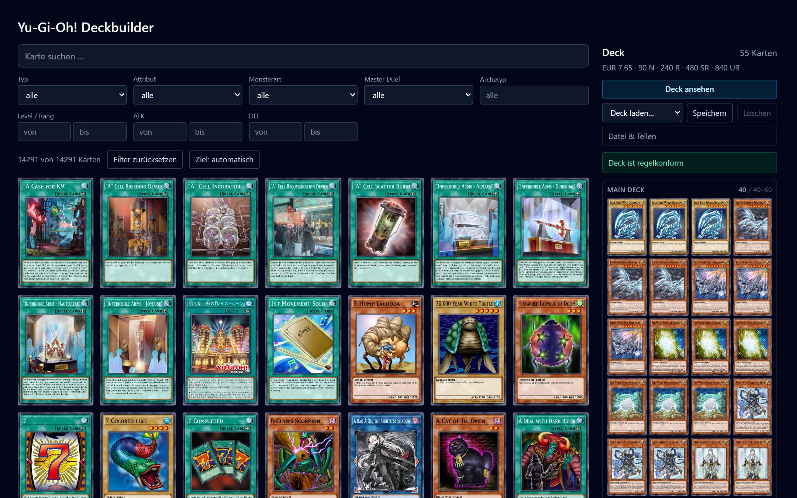
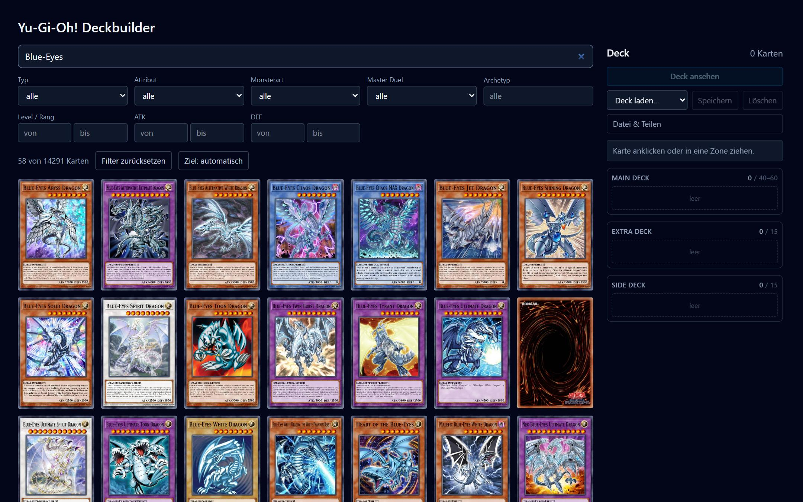
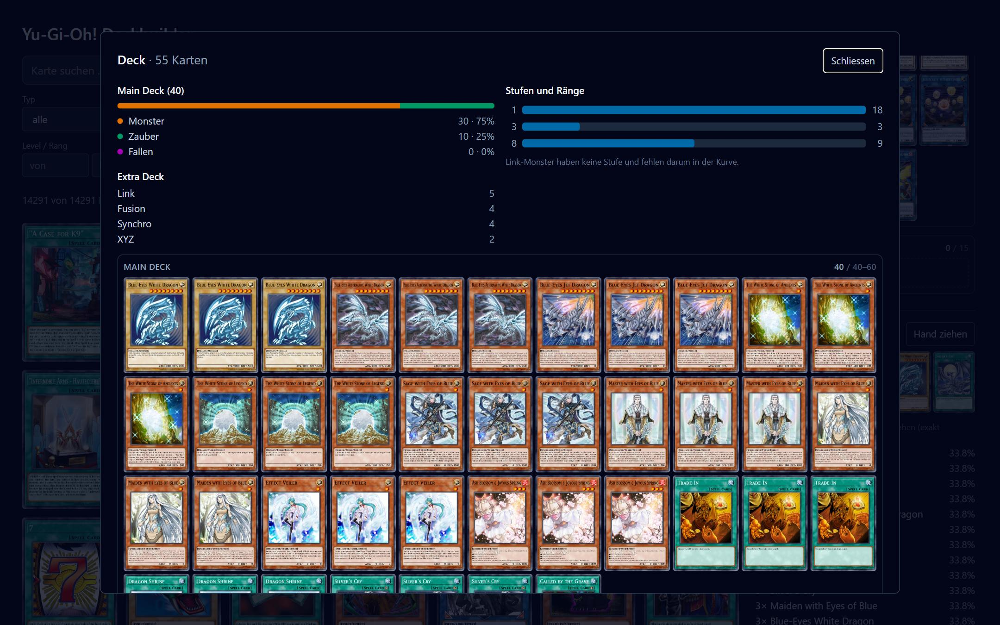
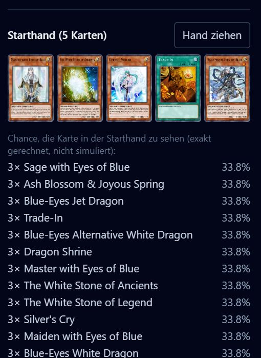

# Yu-Gi-Oh! Deckbuilder

Deckbuilder für das Yu-Gi-Oh! TCG als reine Client-App. Kartensuche mit Filtern,
Deck-Editor mit Main/Extra/Side, Banlist-Prüfung und `.ydk`-Import/Export.

Stack: React + TypeScript, Vite, Tailwind CSS. Kein Backend.



## Funktionen

- Kartensuche über ~14'000 Karten mit Freitext sowie Filtern für Typ,
  Attribut, Monsterart, Archetyp, Level/Rang, ATK, DEF und Master-Duel-Seltenheit
  (inklusive „nicht in Master Duel")
- Deck-Editor mit Main, Extra und Side Deck; Karten per Klick oder
  Drag and Drop hinzufügen, verschieben und entfernen
- Grossansicht des Decks über ein natives `<dialog>` (Esc, Backdrop-Klick und
  Fokusfalle kommen vom Browser), „rückgängig" für die letzte Deckänderung
- Laufende Regelprüfung: Zonengrössen, höchstens drei Kopien über alle
  Zonen zusammen und die aktuelle TCG-Banlist
- Import und Export im `.ydk`-Format
- Das Deck überlebt einen Reload: es liegt im `localStorage` des Browsers;
  daneben lassen sich beliebig viele Decks unter einem Namen ablegen und
  wieder laden
- Auswertung in der Grossansicht: Verhältnis von Monstern, Zaubern und Fallen,
  Stufenkurve der Monster und das Extra Deck nach Art
- Kosten des Decks: Craft-Preis in Master Duel je CP-Topf (N, R, SR, UR sind
  getrennte Währungen) und Summe der Cardmarket-Richtpreise; Karten ohne
  Angabe werden ausgewiesen statt mitgerechnet
- Deck teilen: der Knopf legt einen Link in die Zwischenablage, der das ganze
  Deck im URL-Fragment trägt — kein Server, keine Datenbank
- Starthand: Chance auf jede Karte in den ersten fünf Karten, exakt über die
  hypergeometrische Verteilung gerechnet statt simuliert, dazu eine Beispielhand

## Ansichten

Kartensuche mit Filtern — hier alles, was „Blue-Eyes" im Namen trägt:



Die Grossansicht zeigt das ganze Deck auf einmal, darüber die Auswertung:



Starthand mit den exakt gerechneten Chancen:



## Einrichten

Voraussetzung ist Node.js 22.18 oder neuer (siehe `.nvmrc`). Ältere Versionen
können Vite nicht starten und die Tests nicht ausführen, die direkt als
TypeScript laufen.

```bash
npm install
npm run cards
npm run dev
```

`npm run cards` ist der einmalige Kartenimport (siehe unten). Ohne diesen
Schritt startet die App zwar, zeigt aber nur den Hinweis, dass die
Kartendaten fehlen.

Die Regeln des Deck-Editors und der `.ydk`-Umgang sind mit dem Testrunner von
Node abgedeckt, ohne zusätzliches Testframework:

```bash
npm test
```

## Sicherheit

- `npm audit` meldet keine bekannten Schwachstellen. Ein `npm install` braucht
  keine Zugangsdaten und schreibt nur in `node_modules/`.
- Die App hat kein Backend, keine Logins und speichert nichts ausserhalb des
  Browsers. Alles, was von aussen kommt (geteilte Links, `.ydk`-Dateien,
  `localStorage`), wird beim Einlesen geprüft und nie als HTML eingesetzt.
- Der Kartenimport schreibt Bilder nur nach `public/cards/` und lädt sie nur von
  `images.ygoprodeck.com`. Einträge der API mit ungültiger ID oder fremdem Host
  überspringt er.
- Auf Cloudflare setzt `public/_headers` eine Content-Security-Policy und
  weitere Sicherheits-Header. Die Seite darf dann nur eigene Skripte laden und
  Bilder nur von sich selbst und vom Bilder-Projekt.

## Kartenimport

Die Kartendaten stammen von der [YGOPRODeck-API](https://ygoprodeck.com/api-guide/)
(kostenlos, kein Key nötig). Die API erlaubt 20 Requests pro Sekunde und sperrt
bei Überschreitung für eine Stunde; Bilder dürfen ausserdem nicht hotgelinkt
werden. Deshalb läuft der komplette Datenbezug einmalig beim Entwickeln und
nicht zur Laufzeit:

- `scripts/fetch-cards.mts` holt alle ~14'000 Karten in **einem** Request
  (`?misc=yes`, dadurch sind Master-Duel-Seltenheit und Preise gleich dabei)
- reduziert sie auf die benötigten Felder → `public/cards.json` (~7 MB)
- lädt die Kartenbilder nach `public/cards/<id>.jpg`

Zur Laufzeit macht die App **keine** API-Calls, sie lädt nur `cards.json`.

Optionen:

```bash
npm run cards -- --no-images    # nur das JSON neu erzeugen
npm run cards -- --limit 200    # kleiner Testlauf
npm run cards -- --refresh      # API neu abfragen statt Cache zu nutzen
```

Die Rohantwort der API wird in `scripts/.cache/` zwischengespeichert, damit
wiederholte Läufe die API nicht unnötig belasten. Bereits vorhandene Bilder
werden übersprungen — ein abgebrochener Lauf kann einfach neu gestartet werden.

Die erzeugten Dateien (`public/cards.json`, `public/cards/`, `scripts/.cache/`)
sind bewusst nicht im Repository; sie werden lokal mit `npm run cards` erzeugt.

Die Kartenbilder sind in `vite.config.ts` vom Dateiwächter ausgenommen. Ohne
diese Ausnahme indexiert Vite beim Start alle ~14'000 Bilder und blockiert
dabei den Node-Prozess: das Ausliefern eines einzelnen Bildes dauert dann rund
1.4 Sekunden statt 1 Millisekunde.

## Deployment

Die App ist statisch, das Ausliefern ist darum nur ein Kopieren von `dist/`.
Der einzige Haken sind die ~14'000 Kartenbilder: 400 MB gehören weder ins
Repository noch in jeden Build — sie bei jedem Deploy neu von der API zu holen
dauert Minuten und riskiert die Stundensperre. Deshalb liegen die Bilder
einmalig auf einem eigenen Cloudflare-Pages-Projekt, die App holt sie von dort.

### Einmalig: Bilder hochladen

```bash
npm run cards                 # erzeugt public/cards/ lokal
npx wrangler login            # einmalige Anmeldung im Browser
npx wrangler pages project create ygo-card-images --production-branch main
npm run deploy:images
```

Danach liegen die Bilder unter `https://ygo-card-images.pages.dev/<id>.jpg`.
`wrangler pages deploy` warnt dabei, `wrangler.jsonc` habe kein
`pages_build_output_dir`, und ignoriert die Datei. Das ist richtig so: die
Konfiguration gehört dem Worker der App, mit dem Bilder-Projekt hat sie nichts
zu tun.
Ein Pages-Projekt fasst 20'000 Dateien; die ~14'000 Bilder passen mit Reserve
für kommende Sets. Nach neuen Karten `npm run cards && npm run deploy:images`
wiederholen, sonst fehlt zu einem neuen Eintrag in `cards.json` das Bild.

### Die App selbst

Cloudflare legt neue Projekte als Worker an, nicht mehr als Pages-Projekt.
Wohin die Dateien gehören, steht darum in `wrangler.jsonc` im Repository und
nicht im Formular; im Dashboard bleiben nur zwei Felder zu füllen:

| Feld | Wert |
| --- | --- |
| Build command | `npm run cards -- --no-images && npm run build` |
| Deploy command | `npx wrangler deploy` (Vorgabe) |
| Build variable | `VITE_CARD_IMAGES` = `https://ygo-card-images.pages.dev` |

`VITE_CARD_IMAGES` muss eine **Build**-Variable sein, keine Laufzeitvariable:
Vite setzt den Wert beim Bauen fest in das Bundle ein, zur Laufzeit gibt es
ihn nicht mehr. Ohne die Variable sucht die App die Bilder unter `/cards/` im
eigenen Verzeichnis — genau das, was beim lokalen `npm run dev` gewollt ist.

`--no-images` lässt den Build nur `cards.json` erzeugen: ein einziger Request,
ein paar Sekunden, weit innerhalb der 20 Minuten Build-Zeit.

`public/.assetsignore` hält die Bilder aus dem App-Deployment heraus. Auf
Cloudflare gibt es sie ohnehin nicht (`--no-images`); die Datei wirkt lokal,
wo `dist/` nach einem vollen `npm run cards` alle 14'000 Bilder enthält.

Eine eigene `base` steht nicht in `vite.config.ts`, die App liegt also im
Wurzelverzeichnis der Domain und braucht dafür keine Einstellung.

## Quellen

- Kartendaten und Bilder: [YGOPRODeck](https://ygoprodeck.com/) via
  `https://db.ygoprodeck.com/api/v7/cardinfo.php`
- Preise: Cardmarket-Richtpreise aus derselben API-Antwort. Momentaufnahme des
  Imports, kein Angebot — der echte Preis hängt an Auflage, Zustand und Anbieter.
- Craft-Kosten in Master Duel: 30 CP je Kopie, in der Sorte der Karte. Die vier
  Töpfe (N, R, SR, UR) sind getrennt und nicht gegeneinander tauschbar — eine
  UR kostet 30 UR-CP, nicht 30 beliebige CP.
- Die Screenshots in `docs/` zeigen dieselben Kartenbilder von YGOPRODeck; das
  abgebildete Blue-Eyes-Deck ist ein Beispiel, keine Empfehlung.
- Yu-Gi-Oh! ist eine Marke von Konami. Dieses Projekt ist ein privates
  Lernprojekt ohne Verbindung zu Konami.
